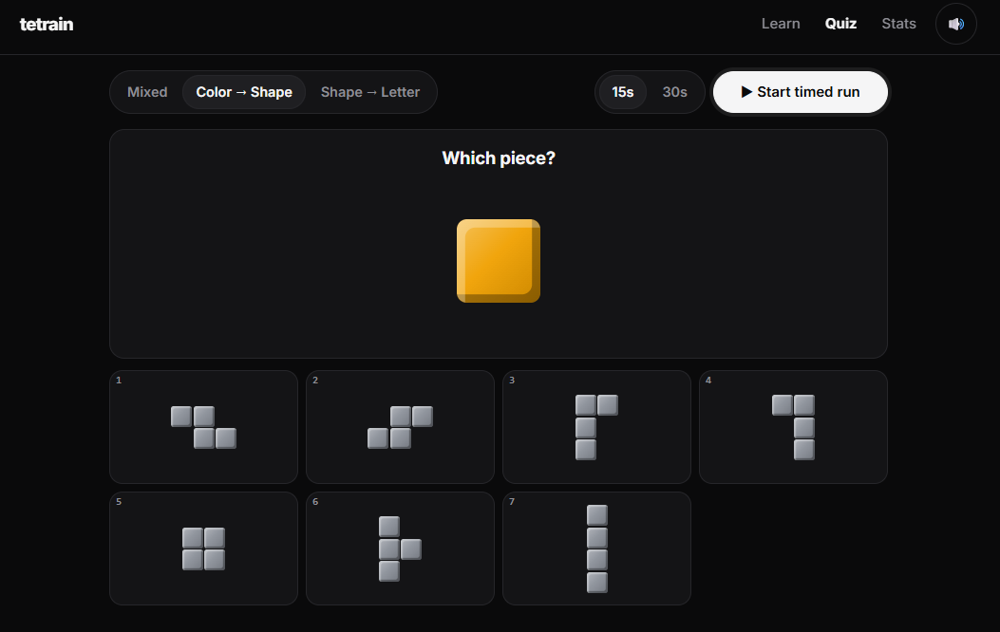
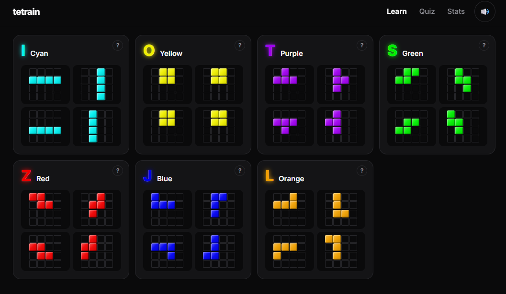
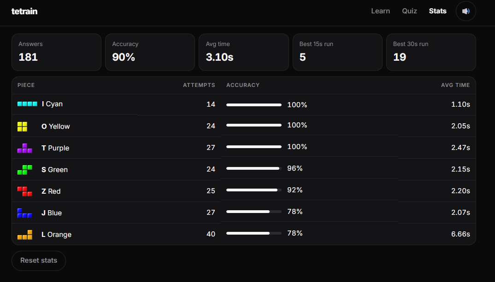

# tetrain

**A web app that drills the Tetris Guideline piece colors and shapes until you recognize every piece, in any rotation, instantly.**

**[➜ Play it at tetrain.vercel.app](https://tetrain.vercel.app)** · Vanilla JavaScript (ES modules) · HTML/CSS · Web Audio · Node test runner · Vercel · no framework, no build step, no dependencies

<p>
  
  
</p>


*Top: the quiz (Color → Shape) and the Learn page. Bottom: the Stats page, where J and L are the weakest pieces, which is exactly what the app drills harder.*

## Why I built it

In fast Tetris games like tetr.io, you have to read the next pieces at a glance. Every split second spent thinking "blue... is that J or L?" is a slower or worse placement. I noticed I was still mixing up J/L and S/Z, the mirror-image pairs, and there wasn't a simple way to practice *just* piece recognition outside a real game.

So I built a focused trainer: learn the pieces, then get quizzed on them at random rotations, with the app adapting to whatever I keep getting wrong. I also wanted it to feel like the game, with combos, sounds and a timed mode, so practicing would actually be fun to come back to.

## What it does

- **Learn:** all 7 pieces in every rotation, each in a 4×4 grid that matches how pieces spawn in the game. Hover a piece (or press and hold on a phone) for its mnemonic and a one-line description.
- **Quiz:** two kinds of question:
  - **Color → Shape:** a color; pick the matching gray piece, shown at a random rotation.
  - **Shape → Letter:** a colored piece at a random rotation; pick its letter.
- **Adaptive practice:** pieces you miss come up more often until you improve, especially J/L and S/Z mix-ups.
- **Game feel:** answers in a row build a combo, with a tetr.io-style popup, a rising sound, and a block burst every 5. A wrong answer flashes the right one in color.
- **Timed runs:** 15s or 30s, ending with your score, accuracy, average answer time and best streak. Each length keeps its own best.
- **Stats:** attempts, accuracy and average time for every piece.
- **Keyboard first:** answer with **1–7** or the piece's letter (**I O T S Z J L**). **M** toggles sound. Works on phones too.

Your stats are saved in your own browser only. No account, no server.

## How it works

- **One source of truth for piece data.** [`src/pieces.js`](src/pieces.js) holds each piece's color, mnemonic, description, cell coordinates for all four SRS rotations, and its place in the 4×4 spawn frame. Nothing else hardcodes a color or shape. Every piece on screen is drawn from this data as a grid of cells.
- **Adaptive weighting.** Each piece's chance of being asked is based on its *recent* accuracy (a sliding window, smoothed so unseen pieces start at 50%). If you answer L for a J, both J *and* L get extra weight, because a mix-up means both are shaky. Once you improve, the weight drops off on its own. The last piece asked is down-weighted so you rarely get the same one twice.
- **Sounds are synthesized, not loaded.** All sound effects are generated with the Web Audio API, including combo tones that rise in pitch with the streak. There are no audio files.
- **No framework, no build.** Plain HTML, CSS and native ES modules served as-is. Each mode is a small module returning `{ el, onShow, onHide }`, registered in `src/main.js`.
- **Tested piece geometry.** Unit tests check that every piece has exactly 4 cells in all 4 rotations, that each rotation is the previous one turned clockwise, that colors match the Guideline, and that every rotation fits the spawn frame. A `/test.html` page renders every piece in every rotation for a visual check.
- **Ready for more modes.** A board model (`src/board.js`) with placement checks is already in place for a future "Fill the Gap" puzzle mode.

## What I learned

- **Build the tool you'd actually use.** I'm my own first user. My stats page showed exactly what I suspected (J and L at 78% while everything else was 90%+), which is what drove the extra weighting for confusable pairs.
- **Small adaptive rules go a long way.** A few lines of weighting math made the quiz feel like it "knows" what I'm bad at, without any complicated spaced-repetition system.
- **Feel matters as much as function.** A plain multiple-choice quiz gets boring fast. Combos, sounds and timed runs are what make it worth coming back to.
- **You don't always need a framework.** Without React or a bundler, the whole app is about 1,300 lines, loads instantly, and deploys by pushing to `main`. Keeping data in one module made redesigns (like reworking the quiz types) quick and safe.
- **Iterate on real use.** The quiz types changed several times as I used it, narrowing down to the two question types that train recognition best.

**What I'd do next:** the "Fill the Gap" mode (place the right piece into a gap on a board), a next-queue reading drill, and optional syncing of stats across devices.

## The pieces

| Piece | Color  | Mnemonic | Hex       | Shape                           |
|-------|--------|----------|-----------|---------------------------------|
| I     | Cyan   | icicle   | `#00F0F0` | 4 in a row                      |
| O     | Yellow | omelet   | `#F0F000` | 2×2 square                      |
| T     | Purple | thanos   | `#A000F0` | 3 in a row, bump in the middle  |
| S     | Green  | spinach  | `#00F000` | Zigzag, rises to the right      |
| Z     | Red    | zit      | `#F00000` | Zigzag, rises to the left       |
| J     | Blue   | jeans    | `#0000F0` | 3 in a row, corner on the left  |
| L     | Orange | lava     | `#F0A000` | 3 in a row, corner on the right |

Rotations follow SRS, the standard rotation system in modern Tetris.

## Tech stack

- **Vanilla JavaScript** (native ES modules), **HTML** and **CSS**. No framework, no bundler, no npm dependencies.
- **Web Audio API** for synthesized sound effects
- **localStorage** for stats and settings
- **Node's built-in test runner** for unit tests
- **Vercel** static hosting; every push to `main` deploys

## Run it locally

**Requirements:** Node 22 or newer.

```bash
npm run dev     # dev server at http://localhost:5173
```

```bash
npm test        # unit tests
```

Browsers block ES modules on `file://` URLs, so opening `index.html` straight from disk won't work. Use the dev server.

<details>
<summary>Deploys and adding a mode</summary>

**Deploys:** every push to `main` goes live at tetrain.vercel.app through Vercel. Other branches get preview links. `vercel.json` tells Vercel to serve the repo root as-is, minus the dev files listed in `.vercelignore`.

**Adding a mode (e.g. "Fill the Gap"):** create `src/modes/<name>.js` that returns `{ el, onShow, onHide }`, then add it to `MODES` in `src/main.js`. The board model is ready:

- A board is `board[y][x]`. Each cell is `null` (empty), a piece letter (`'I'`…`'L'`) or `'G'` (gray). `boardFromRows(['GG..', 'G...'])` builds one from strings.
- `canPlace(board, piece, rotation, x, y)` and `place(...)` treat `(x, y)` as the top-left corner of the piece. `place` returns a new board.
- `legalPlacements`, `emptyCells` and `isFull` help generate and check puzzles. `renderBoard(board, { showGrid: true })` draws any board.

</details>

## Project structure

```
index.html          app shell (top bar with tabs and mute button, <main>)
styles.css          dark theme, beveled block cells, quiz effects, mobile layout
test.html           visual check: every piece × every rotation
serve.js            zero-dependency dev server
src/
  pieces.js         piece data (colors, mnemonics, SRS rotations, spawn frame)  ← source of truth
  board.js          board model: canPlace, place, legalPlacements …
  render.js         renderBoard / renderPiece / renderSwatch (DOM grid)
  stats.js          saved stats, timed-run bests, adaptive piece weighting
  sfx.js            synthesized sound effects (Web Audio) + mute setting
  dom.js            tiny element helper + formatters
  main.js           tab navigation (remembers last tab), mute toggle; registers modes
  modes/            learn.js, quiz.js, stats.js
tests/              node --test unit tests
docs/               README screenshots
```

## About

Built by **Tan Thai**. | [LinkedIn](https://linkedin.com/in/tanthai028) | [GitHub](https://github.com/tanthai028)

Other projects: [Stride](https://github.com/tanthai028/stride-desktop-app) (desktop app for working through job applications) · [yt-transcriber](https://github.com/tanthai028/yt-transcriber) · [YTBookmarks](https://github.com/tanthai028/YTBookmark) · [RJ Job Tracker](https://github.com/tanthai028/RJTracker)
